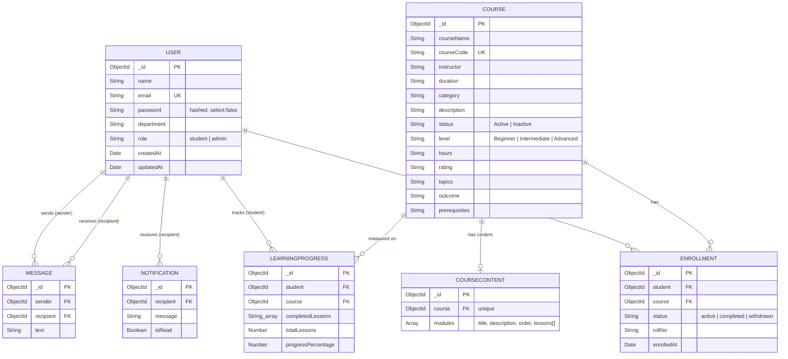

# Database Schema (MongoDB / Mongoose)

Database name (local): `faceprep_course_system`
Connection string: `MONGO_URI` in `backend/.env`.

## DATABASE RELATIONSHIPS

Conceptual relationship diagram. Notifications and chat messages reference users; enrollment and progress reference both users and courses.



Plain-text version:

```
User ──< Enrollment >── Course
User ──< LearningProgress >── Course
User ──< Notification            (recipient)
User ──< Message >── User        (sender / recipient)
```

Every collection also has `createdAt` / `updatedAt` (Mongoose `timestamps: true`).

## Collections

### users  (`models/User.js`)
| Field | Type | Constraints |
| --- | --- | --- |
| name | String | required, trimmed, max 100 |
| email | String | required, **unique**, lowercase, trimmed |
| password | String | required, bcrypt hash, `select: false` (never returned) |
| department | String | optional, max 100 |
| role | String | enum `student` / `admin`, default `student` |

Unique index: `email`.

### courses  (`models/Course.js`)
| Field | Type | Constraints |
| --- | --- | --- |
| courseName | String | required, max 150 |
| courseCode | String | required, **unique**, uppercase, max 30 |
| instructor | String | required, max 100 |
| duration | String | required, max 50 (free text, e.g. `8 Weeks`) |
| category | String | required, max 100 |
| description | String | optional, max 2000 |
| status | String | enum `Active` / `Inactive`, default `Active` |
| level | String | enum `Beginner` / `Intermediate` / `Advanced`, default `Beginner` |
| hours, rating | String | optional, max 20 / 10 |
| topics, outcome | String | optional, max 1000 (topics are comma separated) |
| prerequisites | String | optional, max 500 |

Unique index: `courseCode`.

### coursecontents  (`models/CourseContent.js`)
One document per course holding its syllabus: `modules[]` (title, description, order), each with `lessons[]` (title, description, videoUrl, resourceUrl, order).
Created through `POST /api/v1/courses/:courseId/content/modules` and `.../modules/:moduleId/lessons` (admin).
`GET /api/v1/courses/:courseId/content` is returned only to **enrolled students** and admins.

### enrollments  (`models/Enrollment.js`)
| Field | Type | Constraints |
| --- | --- | --- |
| student | ObjectId → User | required |
| course | ObjectId → Course | required |
| status | String | enum `active` / `completed` / `withdrawn`, default `active` |
| rollNo | String | optional, max 50 |
| enrolledAt | Date | default now |

Unique compound index: `{ student, course }`.
Un-enrolling sets `status` to `withdrawn`; re-enrolling sets it back to `active` (never insert a second document, the unique index would reject it).

### learningprogresses  (`models/LearningProgress.js`)
| Field | Type | Constraints |
| --- | --- | --- |
| student | ObjectId → User | required |
| course | ObjectId → Course | required |
| completedLessons | [String] | default `[]` |
| totalLessons | Number | required, min 0 |
| progressPercentage | Number | 0-100, default 0 |

Unique compound index: `{ student, course }`.

### notifications  (`models/Notification.js`)
| Field | Type | Constraints |
| --- | --- | --- |
| recipient | ObjectId → User | required |
| message | String | required, max 500 |
| isRead | Boolean | default `false` |

Index: `{ recipient: 1, createdAt: -1 }` (latest notifications per user).

### messages  (`models/Message.js`)
| Field | Type | Constraints |
| --- | --- | --- |
| sender | ObjectId → User | required |
| recipient | ObjectId → User | required |
| text | String | required, max 2000 |

Index: `{ sender: 1, recipient: 1, createdAt: -1 }` (conversation history).

## Referential clean-up
MongoDB has no foreign keys, so the API removes dependants itself:
- Deleting a **student** (`DELETE /api/v1/students/:id`) also deletes their enrollments, progress records, notifications and messages (sent or received).
- Deleting a **course** (`DELETE /api/v1/courses/:id`) also deletes its enrollments, progress records and course content.
